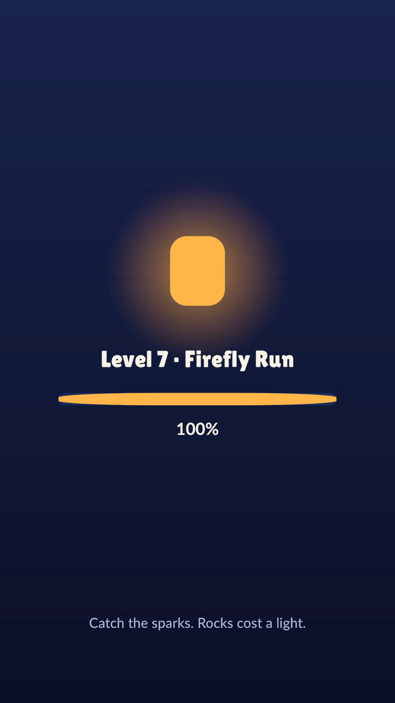
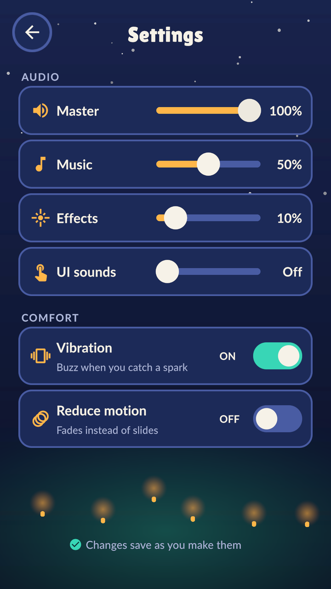
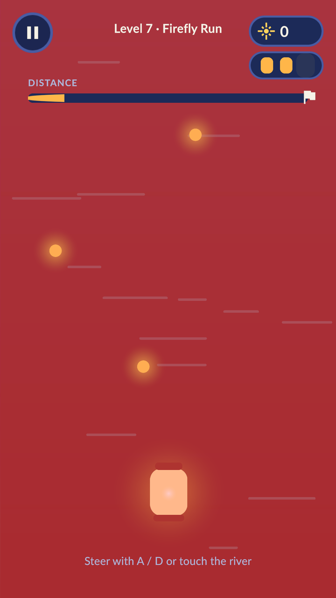
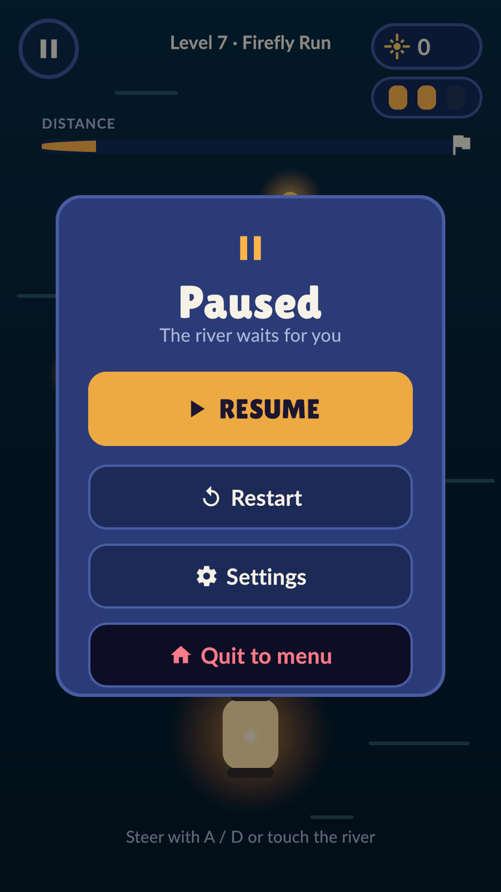
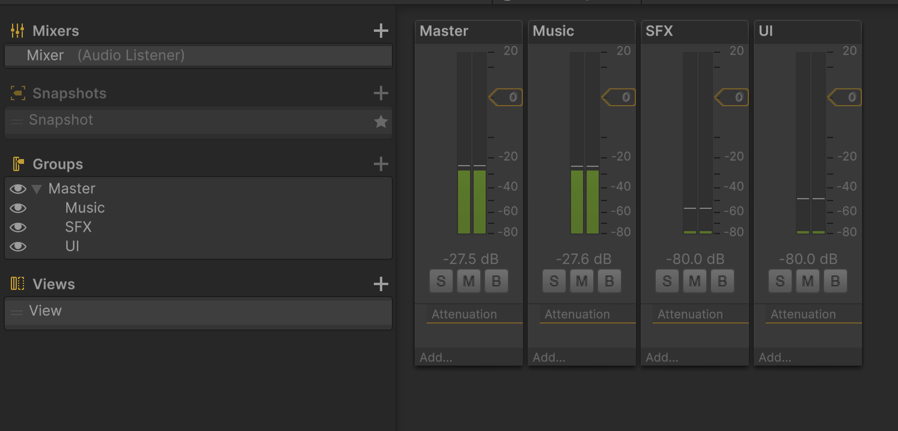

# Riverlight: loading, sound and events (Lab 08)

**Name:** Muhammad Talha
**Roll number:** BSCS23051
**Course:** CS-464 Game Development, Lab 08

**Demo video:** [Riverlight Lab 08 demo, with sound (Google Drive)](https://drive.google.com/file/d/1aIsONX7JLiK5oIo--Wo7pi77QFq6cigt/view?usp=sharing)

This is my Lab 07 project, *Riverlight*, carried on. All 10 Lab 07 screens still work the same way, with the same navigation, tweens and portrait layout: Title, Main Menu, Level Select, Lanterns, Shop, Settings, Gameplay, Pause, Results and Credits. For Lab 08 I added:
- a real loading screen
- an Audio Mixer with four groups and four volume sliders
- UI sounds, gameplay sounds and music that changes with the game
- gameplay that raises C# events for other components to react to.

The Lab 07 design notes (one section per screen) are in this repo's history, and the screenshots are still in `Docs/screens/`.

<p>




</p>

## How to run

1. Open the project in **Unity 6.3 (6000.6.3f1)**.
2. Open `Assets/Scenes/Riverlight.unity`. The build list has two scenes: **Riverlight** (all the menus) and **Gameplay** (the level, Pause and Results).
3. In the Game view, pick **Simulator** and any phone (or a 1080 × 1920 portrait resolution), then press Play.

**Controls:** tap or click the buttons, and Esc is Back everywhere. In the level, steer with A/D, the arrows, or by holding on the river. Catch the sparks and dodge the rocks. Each rock costs one of your 3 lights, and if all three go out you lose the level.

## 1. Loading

The level is now its own scene. When you press Play on Level Select, `SceneLoader` does this:
1. It fades in the loading screen, which shows the level's name, a bar and a percentage. The screen blocks taps, so nothing behind it can be pressed.
2. It starts `SceneManager.LoadSceneAsync("Gameplay")` with `allowSceneActivation = false`.
3. Each frame it shows the real progress, `op.progress / 0.9`, on the bar and as a percentage. Unity reports 0 to 0.9 while loading.
4. When progress reaches 0.9, the bar shows 100%. It holds there for 0.3 s, then turns `allowSceneActivation` on.

So you can't get into the level until it has finished loading. In the new scene, the loading screen fades away.

Going the other way works the same. Results → Levels or Home, and Pause → Quit to menu, load the Riverlight scene behind the same screen. Before the load, `UIRouter.StartPath` is set (for example Title › Main Menu › Level Select). The menu scene then opens on the right screen, and Back still works from there. The loader also sets `Time.timeScale` and `AudioListener.pause` back to normal before it loads, because both survive a scene change.

## 2. The Audio Mixer and the volume sliders

`Assets/Audio/Mixer.mixer` has four groups. Every AudioSource in the game is routed to one of them.

| Group | What goes through it | Exposed volume |
|---|---|---|
| **Master** | everything below | `MasterVolume` |
| **Music** | the two music tracks (MusicPlayer) | `MusicVolume` |
| **SFX** | gameplay effects (SfxPlayer, 4 sources) | `SfxVolume` |
| **UI** | every menu sound (UiAudio, 1 source) | `UiVolume` |

The Audio Mixer window in Play mode, with the music playing through Music and Master, and the peak marks from a few UI clicks on the UI meter:



All the players live on one `AudioRig` prefab that's in both scenes. The first copy survives every scene load (`DontDestroyOnLoad`), and any later copy destroys itself, so the music never doubles. Each scene has exactly one AudioListener, on its Main Camera. The game is all UI, so the camera is where the player "is".

**Volume mapping.** Settings has four sliders: Master, Music, Effects and UI sounds. Each one runs 0 to 1, and `VolumeSettings` turns that into decibels:

```csharp
public static float ToDecibels(float value) => Mathf.Log10(Mathf.Clamp(value, Min, 1f)) * 20f;   // Min = 0.0001
```

| Slider | 1 | 0.5 | 0.25 | 0.1 | 0 |
|---|---|---|---|---|---|
| Volume | 0 dB | −6.02 dB | −12.04 dB | −20 dB | −80 dB (shown as "Off") |

I used a log scale because hearing is logarithmic. With a straight 0–1 line, the top half of the slider would barely change anything. 0 can't go into `Log10` (it's minus infinity), so it's clamped to 0.0001, which is −80 dB. That's the safe mute.

**Saving.** Every change is saved straight away with `PlayerPrefs.SetFloat("MusicVolume", value)` and so on. On launch, `AudioRig.Start` calls `VolumeSettings.ApplyAll`, so the saved volumes are back before you hear anything. I did it in Start because a mixer ignores `SetFloat` in Awake. Settings has no Save button, because there's nothing to forget.

**While paused:**
- The game freezes with `Time.timeScale = 0` and `AudioListener.pause = true`, so the gameplay sounds stop with it.
- The **UI source ignores the listener pause**, so the pause menu and Settings still click.
- The **music keeps playing**, so the menu doesn't go dead silent. It ducks down to 35% over 0.3 s, and comes back up on Resume.

## 3. Sounds

**UI sounds** all go through one `UiAudio` player on the UI group. No button has its own AudioSource.

| Sound | When |
|---|---|
| Hover | mouse over a button, or the keyboard selecting one. Throttled so a sweep doesn't buzz |
| Press | any button or switch |
| Back / Open | going back a page / forward a page (the router plays these) |
| Open / Close | the shop's confirm pop-up |
| Pause / Resume | opening and closing Pause |
| Success | buying something, equipping a lantern |
| Error | a locked level, not enough coins |

**Gameplay sounds** go through `SfxPlayer` on the SFX group: start, spark caught, rock hit, light out (lose) and reached the end (win). It uses `PlayOneShot`, so short sounds can overlap, like two sparks caught close together. Sounds that repeat a lot get a random pitch of ±2 semitones (`2^(semitones/12)`). Hover and press get ±1 semitone, so they don't sound copy-pasted.

**Music.** `MusicPlayer` has two looping sources, so one track can fade out while the other fades in over 1.5 s.
- **Menu → gameplay:** the calm track crossfades into the faster river track when a run starts.
- **Gameplay → results:** winning or losing crossfades back to the calm track under Results.
- **Retry or Next:** the river track comes back.

## 4. C# events

`GameplayScreen` is the publisher. It runs the rules (moving the lantern, sparks, rocks, lights, the timer) and raises events. It doesn't play sounds, shake the screen or update the HUD itself.

```csharp
// GameplayScreen.cs: declaration
public event Action<int, int> Damaged;           // lights left, max lights

// GameplayScreen.cs: invocation, when a rock reaches the lantern
lights--;
Damaged?.Invoke(lights, maxLights);
if (lights <= 0) { End(false); return; }
```

```csharp
// HitFlash.cs: one of the subscribers
void OnEnable() => game.Damaged += Flash;
void OnDisable() => game.Damaged -= Flash;

void Flash(int left, int max) => SetAlpha(alpha);
```

| Event | Listeners |
|---|---|
| `GameStarted` | GameplayHud (resets the counter and lights), GameplaySfx (start sound), GameMusic (river track) |
| `Collected(total)` | GameplayHud (counter + pop), GameplaySfx (spark sound) |
| `Damaged(left, max)` | GameplayHud (a light goes dark), HitFlash (red flash), ScreenShake (shake), GameplaySfx (hit sound) |
| `Died` | ScreenShake (bigger shake), GameplaySfx (lose sound), GameMusic (calm track) |
| `Won` | GameplaySfx (win sound), GameMusic (calm track) |

That's five separate listener components. Each one does `+=` in OnEnable and `-=` in OnDisable, so nothing is left subscribed when the scene unloads. Every event is raised with `?.Invoke`, so it's safe even with no listeners.

## Credits

- **Music and sound effects:** all 16 clips were made by me. `Tools/make_audio.py` synthesises them with numpy: the two music loops, 9 UI sounds and 5 gameplay sounds. There's no third-party audio.
- **Lilita One** by Juan Montoreano, SIL Open Font License 1.1
- **Lato** by Łukasz Dziedzic, SIL Open Font License 1.1
- **Material Icons** by Google, Apache License 2.0
- **Art:** every shape is drawn by code. No AI-generated or stock images.
- **Course:** SfxPlayer, MusicPlayer, VolumeSlider, the Health-style events and the listener pattern are from Lecture 09. The loader and PlayerPrefs are from Lecture 10.
